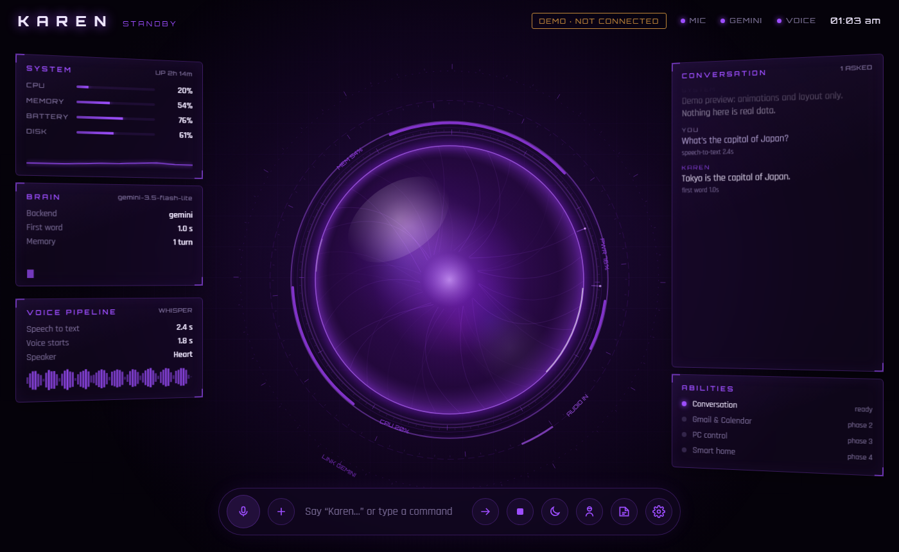
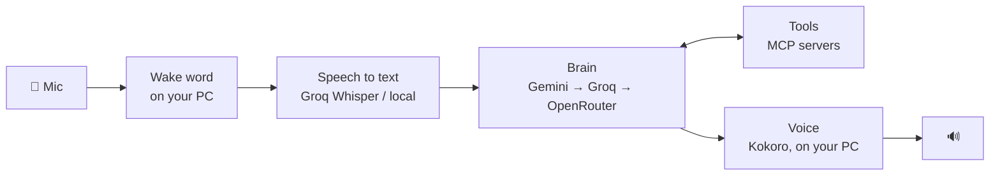

<div align="center">

# K A R E N

**A voice assistant for Windows that runs on your own PC and uses free AI services.**

Say *"Karen"*, then ask anything. She answers out loud and can control your PC, email, phone and smart home.




</div>

---

## What she can do

| | |
|---|---|
| 🗣️ **Talk** | Natural voice (Kokoro), answers in about a second, follows up on questions, can be interrupted |
| 🖥️ **Your PC** | Open/close apps, volume, media, windows, screenshots, files, settings, "click the first song", read the page |
| 📧 **Gmail & Calendar** | Read, summarise and reply to email, check and add events, Drive/Docs/Sheets *(optional)* |
| ⏰ **Everyday** | Weather, news, reminders, timers, to-do lists, notes, morning briefing, "remember that…" |
| 🔎 **Research** | Webcam "what am I holding?", research mode (opens the best sources), PDF research reports |
| 📱 **Android phone** | Calls, SMS, notifications, incoming calls read aloud, "pick up"/"reject" *(optional, over Wi-Fi)* |
| 💬 **From your phone** | Chat with Karen on Telegram when you're out: same brain and tools *(optional)* |
| 🏠 **Smart home** | Lights, fans, plugs and AC through your Alexa account *(optional)* |
| 💪 **Health & focus** | Water, eye and stretch reminders, pomodoro, HIIT timer, BMI/calories, mood log |
| 📄 **Files & PDF** | Convert, merge, split, lock/unlock, compress, watermark, zip, QR codes, tidy a folder |
| 🌍 **Translator** | "How do I say good morning in Spanish?" (spoken in a native voice) |
| 🎙️ **Recorders** | Voice memos and screen recordings |
| 👩 **Anime avatar** | A 3D VRM character instead of the orb, lip-synced to her voice *(optional)* |
| 🔒 **Face unlock** | Only answers you (webcam check) *(optional)* |

Full list of things to say: **[docs/FEATURES.md](docs/FEATURES.md)**

## Safety first

- **She asks out loud first** before anything that sends, deletes, calls, buys or shuts down. You answer yes or no by voice or with a button.
- **Your private data stays private.** Requests that touch your email, files or camera only go to AI providers that keep nothing (zero data retention).
- **Wake word, voice and the fallback speech recognition run on your PC.** Nothing listens until you say "Karen".
- **No programs run behind your back.** The tools are fixed. The one exception is the optional *power mode*, which asks before every risky step.

## Quick start

You need **Windows 10 or 11**, **[Python 3.12](https://www.python.org/downloads/)** and a microphone. A GPU isn't needed.

```bash
git clone https://github.com/rithikbr1974-afk/karen-voice-assistant.git
cd karen-voice-assistant
setup.bat
```

`setup.bat` installs everything (about 1.5 GB of models), then a **setup wizard** walks you through each step:

1. Your name and city.
2. Free AI keys. Each is a 2-minute sign-up and none needs a credit card.
3. Microphone check.
4. Pick Karen's voice.
5. Optional: Gmail, Telegram, phone, Alexa and extras.
6. Teach her your voice.

Then start her with **`run.bat`**, and say *"Karen, what's the weather today?"* You can also press **Space** to talk, or type.

📘 **Step-by-step guide with every detail:** [docs/SETUP.md](docs/SETUP.md)
🎙️ **Teach Karen your voice (wake word training):** [docs/TRAINING.md](docs/TRAINING.md)

## How it works



- **Brain:** free OpenAI-compatible AI APIs, tried in order. If one is busy, the next one answers.
- **Tools:** small [MCP](https://modelcontextprotocol.io) servers in `servers/`. To keep each request small, a request only sends the tools it needs.
- **Everything is a small swappable part** in `core/` (`audio`, `wake`, `stt`, `brain`, `tools`, `tts`, `ui`).

```
main.py          the voice loop and the window        remote.py      Telegram / WhatsApp chat
config.yaml      every setting                        setup.py       the setup wizard
core/            mic, wake word, speech, brain, voice, window, reminders, face unlock, phone watcher
servers/         pc_control · daily · files · dev · explore · dots · jarvis · phone · alexa
scripts/         model download, voice training, phone pairing, Alexa sign-in, autostart
ui/              the window (HTML/CSS/JS, three.js avatar)
```

## Adding a new ability

Write an MCP server (see `servers/daily/server.py` for a small example) and add it to `config.yaml → mcp_servers`
with the trigger words that should offer its tools. For anything that sends, deletes or spends, add its name to
`confirm` so that Karen asks first.

## Credits

Karen is built on these open projects. Thank you!

- [Kokoro](https://github.com/thewh1teagle/kokoro-onnx) (voice)
- [faster-whisper](https://github.com/SYSTRAN/faster-whisper) (speech recognition)
- [openWakeWord](https://github.com/dscripka/openWakeWord) (wake word features)
- [Silero VAD](https://github.com/snakers4/silero-vad) (voice activity detection)
- [MCP](https://github.com/modelcontextprotocol/python-sdk) (tool servers)
- [google_workspace_mcp](https://github.com/taylorwilsdon/google_workspace_mcp) (Gmail and Calendar)
- [three.js](https://threejs.org) and [three-vrm](https://github.com/pixiv/three-vrm) (avatar)
- [OpenCV Zoo](https://github.com/opencv/opencv_zoo) (face unlock)
- [AlexaPy](https://gitlab.com/keatontaylor/alexapy) (smart home)
- [Open Interpreter](https://github.com/OpenInterpreter/open-interpreter) (power mode)
- Several tool ideas were inspired by [jarvis-ai-assistant](https://github.com/Avinashb722/jarvis-ai-assistant) (MIT).

The avatar uses pixiv's free sample VRM model, which is downloaded at setup and not stored in this repository.
Motion files from Mixamo are yours to download; see [docs/SETUP.md](docs/SETUP.md#anime-avatar).

## License

[MIT](LICENSE). You can use, change and share this freely.
